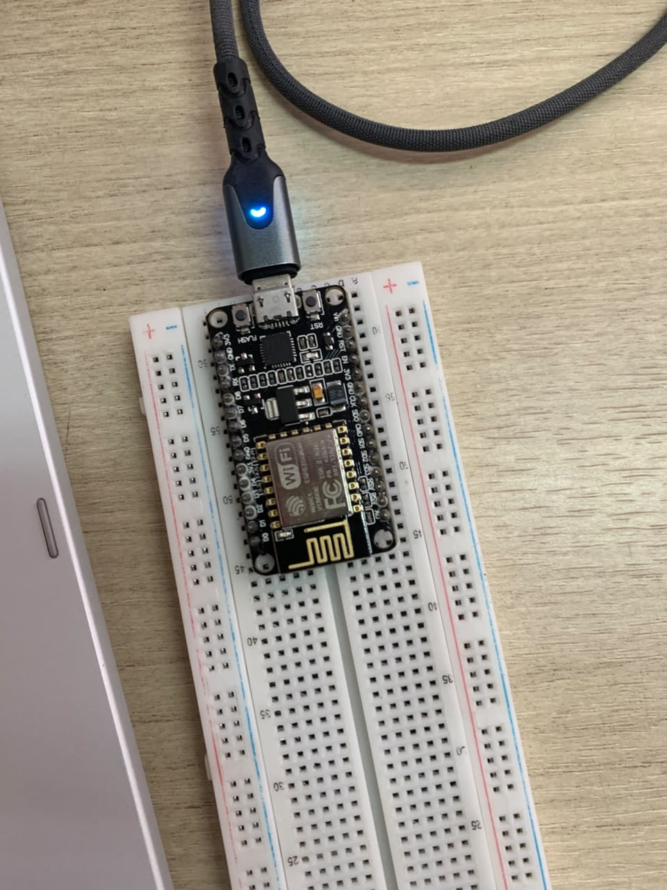

# Percobaan 5A – Pengolahan Data Sensor pada ESP8266

## A. Deskripsi Praktikum

Percobaan 5A membahas pengolahan data sensor pada sisi perangkat atau *edge processing*. Data suhu diolah langsung oleh NodeMCU ESP8266 menggunakan metode moving average untuk menghaluskan perubahan nilai suhu, serta pencatatan suhu minimum, maksimum, dan simpangan baku. Karena sensor DHT22 tidak tersedia saat praktikum, pembacaan suhu digantikan dengan fungsi simulasi (`bacaSuhuMock()`).

## B. Tujuan Praktikum

1. Memahami konsep pengolahan data pada sisi perangkat (*edge processing*).
2. Mengimplementasikan filter moving average dari lima pembacaan suhu terakhir.
3. Mencatat nilai suhu minimum dan maksimum selama program berjalan.
4. Menghitung simpangan baku untuk mengetahui sebaran data suhu.
5. Membandingkan data suhu mentah dengan hasil pengolahan melalui Serial Monitor.

## C. Alat dan Bahan

- NodeMCU ESP8266
- Kabel USB
- Laptop atau komputer
- Arduino IDE
- Serial Monitor
- Data suhu simulasi sebagai pengganti sensor DHT22

## D. Gambar Rangkaian dan Dokumentasi

## E. Penjelasan Program

Program menggunakan beberapa fungsi utama untuk mengolah data suhu simulasi.

1. **Fungsi `bacaSuhuMock()`**

   Fungsi ini menghasilkan data suhu simulasi yang menyerupai perubahan suhu sensor. Nilai suhu dibuat berfluktuasi secara bertahap menggunakan fungsi sinus, ditambahkan noise acak kecil, dan diberi lonjakan suhu sebesar 8°C setiap 25 pembacaan.

2. **Variabel `buffer[N]`**

   Array dengan ukuran `N = 5` digunakan untuk menyimpan lima data suhu terakhir yang akan diproses oleh moving average.

3. **Fungsi `hitungMovingAverage()`**

   Fungsi ini menyimpan data suhu terbaru ke dalam buffer, menghitung total data yang tersedia, kemudian membaginya dengan jumlah data untuk mendapatkan nilai rata-rata bergerak.

4. **Operasi `(indeks + 1) % N`**

   Operasi modulo membuat indeks bergerak ke posisi berikutnya dan kembali ke indeks nol setelah mencapai batas buffer. Dengan demikian, buffer dapat digunakan berulang kali tanpa mengakses elemen di luar ukuran array.

5. **Pencatatan suhu minimum dan maksimum**

   Variabel `suhuMin` dan `suhuMax` diperbarui ketika ditemukan data yang lebih rendah atau lebih tinggi daripada nilai sebelumnya.

6. **Fungsi `hitungSimpanganBaku()`**

   Fungsi tambahan ini menghitung simpangan baku dari data yang tersimpan di buffer untuk mengetahui seberapa besar penyebaran nilai suhu terhadap rata-ratanya.

7. **Serial Monitor**

   Hasil pengolahan ditampilkan setiap dua detik, meliputi suhu mentah, hasil moving average, suhu minimum, suhu maksimum, dan simpangan baku.

## F. Hasil Pengamatan

Berdasarkan pengujian, program berhasil menghasilkan data suhu simulasi dan mengolahnya menggunakan moving average dengan jendela lima data. Program juga dapat mencatat nilai minimum dan maksimum serta menghitung simpangan baku dari data yang tersedia.

Ketika terjadi lonjakan suhu mentah, hasil moving average mengalami kenaikan yang lebih bertahap karena nilai tersebut dirata-ratakan dengan data lain di dalam buffer. Sebagai contoh, pada salah satu pengujian, suhu mentah mencapai 38,22°C, sedangkan nilai filter naik lebih bertahap menjadi sekitar 31,72°C. Sementara itu, nilai suhu maksimum tetap mencatat lonjakan tersebut.

Hasil ini menunjukkan bahwa moving average dapat meredam pengaruh perubahan suhu yang tiba-tiba. Namun, hasil filter juga menjadi sedikit lebih lambat dalam mengikuti perubahan suhu dibandingkan data mentah.

## G. Pertanyaan Praktikum

### 1. Gambarkan alur perhitungan moving average pada fungsi `hitungMovingAverage()`.

Alur perhitungannya adalah:

1. Menerima nilai suhu terbaru.
2. Menyimpan nilai tersebut ke posisi buffer berdasarkan indeks.
3. Menggeser indeks ke posisi berikutnya menggunakan `(indeks + 1) % N`.
4. Memperbarui jumlah data yang telah masuk.
5. Menjumlahkan seluruh data yang tersimpan dalam buffer.
6. Membagi total data dengan jumlah data yang tersedia.
7. Mengembalikan hasil rata-rata sebagai nilai suhu filter.

### 2. Apa fungsi operasi `(indeks + 1) % N`?

Operasi tersebut digunakan untuk menggeser indeks ke posisi berikutnya dan mengembalikannya ke nol ketika mencapai batas ukuran buffer. Dengan ukuran buffer lima, indeks akan bergerak dari 0, 1, 2, 3, 4, kemudian kembali ke 0. Mekanisme ini disebut circular buffer dan memungkinkan data lama digantikan oleh data baru.

### 3. Apa dampak perubahan ukuran N terhadap hasil filter?

Jika nilai N diperbesar, hasil moving average menjadi lebih halus karena lebih banyak data digunakan untuk menghitung rata-rata. Namun, filter menjadi lebih lambat dalam merespons perubahan suhu. Sebaliknya, jika N diperkecil, filter lebih cepat mengikuti perubahan suhu, tetapi lebih mudah terpengaruh noise atau lonjakan sesaat.

### 4. Jelaskan fungsi simpangan baku pada program.

Simpangan baku digunakan untuk mengetahui seberapa jauh nilai suhu dalam buffer tersebar dari rata-ratanya. Perhitungannya dilakukan dengan mencari rata-rata data, menghitung kuadrat selisih setiap data terhadap rata-rata, menentukan varians, kemudian mengambil akar kuadratnya. Simpangan baku yang kecil menunjukkan data cenderung berdekatan, sedangkan nilai yang besar menunjukkan penyebaran data lebih tinggi.

## H. Analisis

Pengolahan data pada ESP8266 memungkinkan data suhu diproses langsung pada perangkat tanpa perlu mengirimkannya ke komputer atau server terlebih dahulu. Moving average membantu mengurangi fluktuasi dan pengaruh lonjakan sesaat, sedangkan pencatatan nilai minimum dan maksimum tetap menunjukkan rentang suhu yang pernah terbaca. Simpangan baku melengkapi analisis dengan memberikan gambaran mengenai penyebaran data.

Ukuran jendela moving average perlu disesuaikan dengan kebutuhan sistem. Jendela yang besar menghasilkan data lebih stabil, tetapi responsnya lebih lambat. Sebaliknya, jendela kecil memberikan respons lebih cepat dengan kemampuan peredaman noise yang lebih rendah.

## I. Catatan Kendala

Kendala utama dalam praktikum adalah sensor DHT22 tidak tersedia sehingga data suhu berasal dari fungsi simulasi `bacaSuhuMock()`, bukan dari pengukuran sensor fisik. Meskipun demikian, data simulasi dibuat memiliki fluktuasi, noise, dan lonjakan suhu agar proses moving average dan perhitungan statistik tetap dapat diuji.

## J. Kesimpulan

1. NodeMCU ESP8266 berhasil menjalankan pengolahan data suhu simulasi menggunakan metode moving average.
2. Moving average dengan lima data dapat menghaluskan perubahan suhu dan mengurangi pengaruh lonjakan sesaat.
3. Program berhasil mencatat suhu minimum dan maksimum serta menghitung simpangan baku dari data pada buffer.
4. Pengolahan data secara langsung pada perangkat memungkinkan analisis sederhana dilakukan tanpa bergantung pada komputer atau server.
5. Penggunaan data simulasi memungkinkan fungsi pengolahan diuji meskipun sensor DHT22 tidak tersedia.
